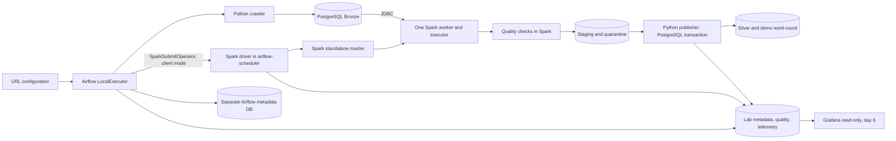

# Kiến trúc đã chọn cho baseline

Sơ đồ là baseline cả tuần. `compose.yaml` bật hai PostgreSQL, Airflow và Spark
master/worker. Ngày 2 đã có fixture → Spark clean/tokenize/count → staging →
transaction publish Silver/demo, control metadata tối thiểu và chặn text rỗng.
Crawler, quality/quarantine đầy đủ, catalog/lineage và Grafana thuộc các ngày sau.
Runtime/kiểm chứng xem [STATUS](../STATUS.md), lệnh xem [day1](day1.md)/[day2](day2.md).

## Service và kết nối

| Service | Vai trò | Cổng host dự kiến → container |
|---|---|---|
| airflow-db | Airflow metadata PostgreSQL riêng | Không publish |
| lab-db | Bronze/Silver/staging/quarantine/metadata/quality/telemetry/demo | Không publish; query qua psql trong container |
| airflow-init | Migrate DB, khởi tạo auth local, chạy một lần | Không publish |
| airflow-api-server | API/UI và task execution API Airflow 3 | 127.0.0.1:8080 → 8080 |
| airflow-scheduler | LocalExecutor, Python tasks, spark-submit và driver | 39001/39002 chỉ trong network |
| airflow-dag-processor | Parse DAG theo kiến trúc Airflow 3 | Không publish |
| spark-master | Standalone coordinator, RPC 7077 | 127.0.0.1:8081 → 8080 |
| spark-worker | Một worker; executor thực thi transformation | 127.0.0.1:8082 → 8081 |
| grafana | Ngày 6: datasource observer và provision dashboard | 127.0.0.1:3000 → 3000 |

Chưa dùng deferrable operator nên chưa cần triggerer. Không Celery worker/Redis.
Compose riêng của lab sẽ dựa trên tài liệu Airflow 3, không chép nguyên quick-start
Celery. Compose CLI đang cài là 5.1.3; giữ cú pháp `docker compose` và feature set
tương thích Compose v2.14+ theo đặc tả, chưa cần downgrade CLI.

Một Docker bridge network cho lab; PostgreSQL có named volume riêng từng DB,
Airflow logs và Spark work dùng volume riêng. Code/jobs/config/fixture mount read-only
tại `/opt/lab`; init xử lý quyền named volumes theo UID thực tế. Không chmod đệ quy
workspace Windows. Spark work phải ghi được bởi user của custom runtime.

## Spark runtime và submit

- Nguồn Spark/JRE là image apache/spark đã pin; Python runtime từ Airflow image
  đã pin. Shared custom runtime dùng cho scheduler/master/worker để cùng Python 3.11.
  Worker có thêm thư viện Airflow là giản lược có chủ đích cho lab, không phải
  tách image tối ưu production. Dùng chung layers để giảm chi phí đĩa.
- Không dùng Python có sẵn của Spark Ubuntu image để giả định trùng Python Airflow.
  Dockerfile ngày 1 phải kiểm tra Java runtime sau copy và Python patch thực tế.
- `SparkSubmitOperator`, `deploy_mode=client`, master `spark://spark-master:7077`.
- `spark.driver.host=airflow-scheduler`, `spark.driver.bindAddress=0.0.0.0`,
  `spark.driver.port=39001`, `spark.blockManager.port=39002`.
- Driver và executor đọc `/opt/lab`; Python executable cùng đường dẫn trong shared image.
  JDBC JAR version/checksum khóa ở bước build, đặt ở classpath driver/executor;
  không tải bằng `--packages` lúc task chạy.
- `max_active_runs=1`, Airflow parallelism 1 và Spark pool 1; worker 2 cores,
  executor 1 GiB, driver 1 GiB là mức khởi điểm đã chạy smoke ngày 1; chưa đo tải lớn.
- Tắt speculation; ban đầu `spark.task.maxFailures=1` cho JDBC staging nhỏ;
  Airflow retry cả attempt và cleanup. Sau này chỉ tăng khi đã chứng minh an toàn ghi.
- Healthcheck DB/Airflow/Spark và pre-submit check worker registered; không coi
  TCP port mở hoặc `depends_on` là đủ để worker sẵn sàng nhận executor.
- Không Docker socket/`docker exec` trong DAG; không Spark local mode để nghiệm thu.
  XCom chỉ có run_id/attempt_id, dataset names và thống kê nhỏ.

## Bảy block và giản lược

Storage: PostgreSQL quan hệ; Access: roles/GRANT; Metadata: bảng + code đăng ký;
Quality: Spark/rules versioned; Orchestration: Airflow; Execution: Spark;
Monitoring: telemetry chủ động + Grafana. Một sản phẩm có thể phục vụ nhiều block.
Metadata không tự sinh logic xử lý; Grafana dashboard là giám sát vận hành,
không thay cho Gold/BI nghiệp vụ. Data Ops/Model/Governance xuyên suốt Bronze→Silver;
crawler mô phỏng Integration, Docker/storage/network mô phỏng Infrastructure.

Nguồn: [Airflow Docker](https://airflow.apache.org/docs/apache-airflow/3.3.2/howto/docker-compose/index.html),
[Spark standalone](https://spark.apache.org/docs/4.0.2/spark-standalone.html),
[Spark configuration](https://spark.apache.org/docs/4.0.2/configuration.html),
[JDBC](https://spark.apache.org/docs/4.0.2/sql-data-sources-jdbc.html).
